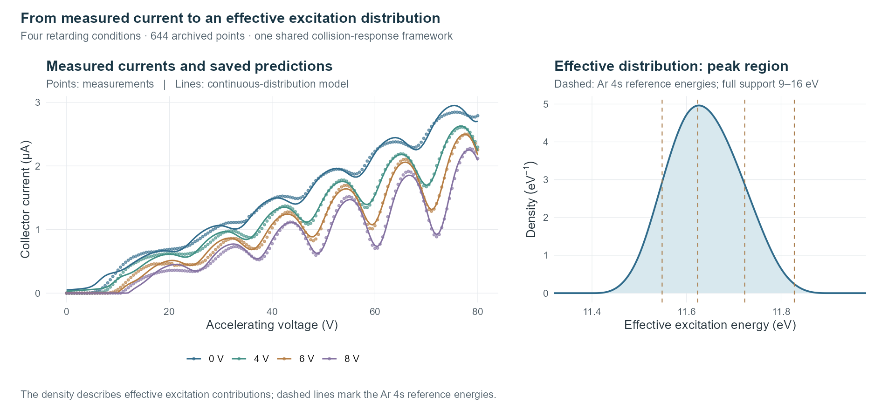
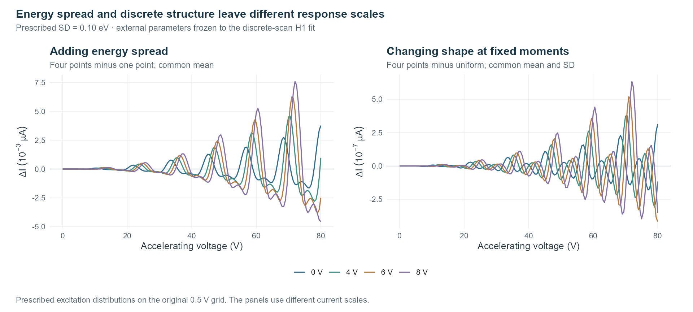

# 氩 Franck–Hertz 激发能量分析

用于描述氩 Franck–Hertz 实验集电极电流响应的可复现模型。Python 实现碰撞响应与不同激发能量假设，R 绘制保存结果及受控对照。

[English](README.md) · [模型设计](docs/design.md) · [复现说明](docs/reproduction.md) · [离散结构诊断](docs/discrete_diagnostics.md)

## 结果预览



电流拟合使用阻滞电压 **0、4、6、8 V 的 644 个档案测量点**。右图放大定义在 9–16 eV 上的分布峰区，均值约为 11.640 eV。该分布描述给定模型下对电流响应的有效贡献，不是直接测得的原子光谱或态布居。

## 快速启动

复用已包含 [requirements.txt](requirements.txt) 所列依赖的 Python 环境，运行：

```text
python run.py
```

| 模式 | 内容 | 是否运行优化器 |
| --- | --- | --- |
| **1** | 重放 H1 和六个连续分布阶段，计算电流与分布统计量。 | 否 |
| **2** | 用 R/ggplot2 重绘保存结果图及三幅项目展示图。 | 否 |
| **3** | 从保存的 H1 起点接续既有交替拟合。 | **是** |
| **4** | 重放 34 组离散／固定方差全数据模型，以及固定外部框架的响应探针。 | 否 |
| **0** | 退出。 | 否 |

建议先运行模式 1，再查看模式 4。每次运行写入新的 `outputs/<时间>_<模式>/`，保留输入和参考结果。数值模式使用单线程 CPU、float64，不要求 CUDA，不自动安装依赖或下载数据。

R 的查找方式、包检查、输出文件和拟合说明见[复现文档](docs/reproduction.md)。

## 让 AI 智能体协助复现

在本地 AI 编程智能体中打开本仓库，复制下面的指令。智能体将依据本机现有环境，逐步准备依赖并核对保存结果。

```text
请协助我在本地复现本仓库，依据这台机器的实际环境逐步推进。

1. 先阅读 README.zh-CN.md、docs/reproduction.md 和 requirements.txt。
   检查操作系统、可用 Python 解释器与环境、已安装包及版本。
   单独检查 Rscript、实际进程可见的 R 库、Cairo 和字体。
2. 先报告环境清单和所需的最小配置步骤。优先复用兼容的现有环境；
   确需新建时，使用项目内独立环境，保留全局依赖。
   在当前授权范围内仅补齐缺失依赖，不替换已有环境，
   不为本项目的 CPU 计算安装 CUDA。
3. 使用选定的 Python 解释器运行 run.py，选择模式 1。
   阅读 replay_checks.json 和分布统计量，对比复算电流与保存值，
   说明实际差异；如有异常，先定位原因。
4. 选择模式 4，重放 34 组全数据模型和固定框架探针。
   检查电流／探针差异及参数是否保持不变。留出和扰动表是保存记录，
   该模式不会重新执行这些拟合。
5. 按需准备 R 绘图环境，优先复用已有安装；缺少 R 或所需包时，
   在当前授权范围内补齐，使同一进程能找到 Rscript 和依赖包。
   必要时使用会话级配置，再运行模式 2 并查看图件。
   若配置受限，说明具体阻碍，保留已完成的 Python 复算结果。
6. 保持原始测量、保存参数和源码不变，所有运行写入新的输出目录。
   只有我明确要求重新拟合，并约定计算预算后，才运行模式 3。
7. 最后报告解释器与依赖版本、实际配置改动、已运行模式、输出位置
   和复算差异。区分参数重放、图件重绘与重新拟合，
   不将这些活动表述为新的独立测量。
```

## 模型设计

单一有效能量、带权离散能量和归一化连续密度，共用同一套电流响应框架。独立连续碰撞通过卷积幂组合，再经过一次单位面积高斯响应和公共电流读出。

[模型设计与数据流](docs/design.md)说明哪些结构保持一致、不同表示改变了什么，以及能量方差为何能与响应展宽相互补偿。[教学任务](docs/teaching_case_zh.md)将这些设计连接到激发、收集与卷积。

## 曲线能区分什么？



图中的分布是人为规定的诊断探针，不是恢复出的原子能级。引入能量展宽对电流的影响，明显大于保持均值和方差后改变分布形状的影响。两图纵轴尺度不同，均不表示仪器检测阈值。

整理后的[离散结构诊断](docs/discrete_diagnostics.md)包含 K=1–8 扫描、匹配预算 H1 对照、固定方差轮廓及原有优化状态。现有档案与协议**没有提供稳定的预测证据来分辨分立能级数量**。窄能域属于强先验；预算末仍在改善的路径保留“尚未稳定”标记。

## 仓库结构

| 位置 | 内容 |
| --- | --- |
| `src/fh_argon/` | 公共电流响应、复算／拟合流程和仅供前向计算的离散通道。 |
| `data/` | 原始工作簿及五曲线、805 点概览表；四曲线拟合使用其中 644 点。 |
| `reference/` | 连续分布阶段、起始参数、绘图源表及精选离散诊断。 |
| `figures/` | 保存结果图和网页展示图的 R 源码。 |
| `docs/` | 设计、复现、解释边界、教学任务和已提交的预览图。 |

[历史四能量对照](docs/optional_h4s.md)来自早期五曲线周期响应模型，与当前碰撞卷积分析分开说明。

## 解释边界与许可

内部留出、优化初值和残差扰动均复用同一实验档案，不是独立实验或已校准置信区间。有效分布不测量原子布居；未分辨出分量，也不能推出真实原子能级不存在。

源码采用 [MIT 许可证](LICENSE)。本仓库提供实现、数据、设计说明和计算记录。
