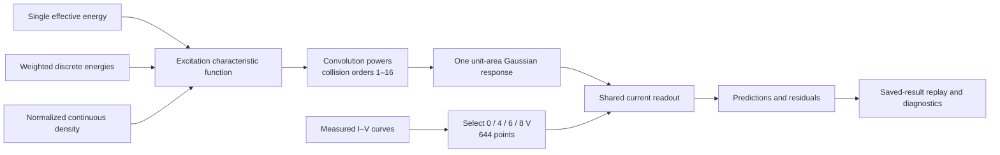

# Model design and data flow

[Project](../README.md) · [复现 / Reproduction](reproduction.md) · [Diagnostics](discrete_diagnostics.md)

The design changes the excitation representation while retaining a shared current-response model. The recorded fits are conditional on that model and on one experimental archive.

## Data and forward calculation

The original workbook contains five curves. The current convolution analysis selects retarding voltages 0, 4, 6, and 8 V; the 10 V curve remains available in the data overview. Workbook values retain the original float32 conversion before float64 calculation. The code does not rescale measured voltage or current to improve agreement.

## Excitation representations

| Representation | Mathematical input | Implementation |
| --- | --- | --- |
| H1 | A point mass at one effective energy. | `RenewalSpectrum`, family H1 |
| Free discrete | Nonnegative weights on K energies; coincident energies and zero weights are permitted in the recorded scan. | `DiscreteChannel` |
| Continuous | A nonnegative, normalized cubic B-spline density on 9–16 eV. | `RenewalSpectrum`, family C |
| Fixed variance | Symmetric two/four-point distributions or a uniform density, with prescribed SD and fitted mean. | `FixedVarianceChannel` |

The forward-only channel classes replay the archived parameters; they do not provide a new scan optimizer. The original continuous fitting workflow remains available through mode 3.

## Successive collisions and the two widths

For independent, identically distributed excitation energies with distribution $p(E)$, the loss after $n$ collisions follows $p^{*n}$. In Fourier space the implementation sums powers of the characteristic function through collision order 16, then applies the common Gaussian response. The numerical loss grid has spacing 0.025 eV and an FFT period of 409.6 V.

The variance of each broadened collision-order contribution, expressed on the voltage axis, is

$$
\operatorname{Var}(V_n)=n\operatorname{Var}(E/e)+\sigma_R^2.
$$

Here $e$ is the elementary charge and $\sigma_R$ is the common Gaussian response width in volts. Numerically, electron energies in eV correspond to voltage losses in V. Reusing the same random energy in every collision would instead give an $n^2$ dependence and is a different assumption.

The shared readout contains the saved baseline, current-growth, collection, contrast, damping, and phase terms. The Gaussian is applied once to each summed response; it is not reapplied as an additional fitted smoothing step after prediction. The retained `_compat` modules supply this readout and parameter transformations.

## Updating and comparing parameters

The continuous workflow starts from saved H1 parameters and alternates updates of the distribution and external framework. Replacing a point mass by the initial spline already introduces finite width. Later changes must be read against that initialization, not described as width emerging from zero.

There are three distinct H1 references: the main continuous-workflow reference, the discrete-scan H1, and the fixed-variance scan's H1 after matched-budget continuation. The curated manifest gives each saved model a separate identifier. Fixed-framework probes use the discrete-scan H1/H4 parameters, never the main continuous fit's H1 parameters.

For a controlled shape comparison, both candidates share the external parameters, mean, and variance. Comparing a spread distribution with a point tests a different question. Separately refitted candidates additionally allow the mean and external framework to compensate.

## Replaying and interpreting

Modes 1 and 4 only load saved parameters and calculate forward outputs. Mode 2 draws saved tables with R. Mode 3 explicitly runs the adopted continuous optimization. Each action writes to a new output directory; saved reference data are read-only inputs.

A distribution peak near a spectroscopic reference is a comparison after fitting. It does not identify atomic populations or prove a resolved level count. See [discrete diagnostics](discrete_diagnostics.md) for the comparisons that test these limitations directly.

## 中文要点

- 数据为同一档案中的四条曲线、644 点；10 V 曲线只保留在原始数据概览中。
- 单能量、离散能量和连续密度改变激发表示，共用碰撞卷积与电流读出。连续碰撞采用独立同分布假设；将能量损失换算到电压轴后，第 n 阶贡献的方差为 `n × 单次损失方差 + 响应方差`。
- 连续拟合、离散扫描和方差扫描的 H1 参数不同；固定框架探针使用离散扫描自己的参照。
- 模式 1、4 仅前向复算，模式 2 仅重绘，模式 3 才进行拟合。三种活动均不增加独立测量。
