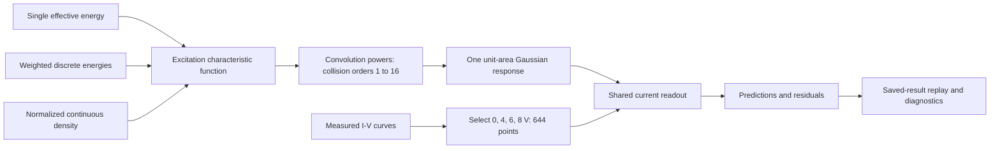

# Model design and data flow

[Project](../README.md) · [复现 / Reproduction](reproduction.md) · [Diagnostics](discrete_diagnostics.md)

The excitation representations share one collision-response model and current readout.

## Data and forward calculation

The original workbook contains five curves. The current convolution analysis selects retarding voltages 0, 4, 6, and 8 V; the 10 V curve remains available in the data overview. Workbook values retain the original float32 conversion before float64 calculation.

## Excitation representations

| Representation | Mathematical input | Implementation |
| --- | --- | --- |
| H1 | A point mass at one effective energy. | `RenewalSpectrum`, family H1 |
| Free discrete | Nonnegative weights on K energies; coincident energies and zero weights are permitted in the recorded scan. | `DiscreteChannel` |
| Continuous | A nonnegative, normalized cubic B-spline density on 9–16 eV. | `RenewalSpectrum`, family C |
| Fixed variance | Symmetric two/four-point distributions or a uniform density, with prescribed SD and fitted mean. | `FixedVarianceChannel` |

The channel classes replay saved discrete parameters. Mode 3 continues the continuous-distribution fit.

## Successive collisions and the two widths

For independent, identically distributed excitation energies with distribution $p(E)$, the loss after $n$ collisions follows $p^{*n}$. In Fourier space the implementation sums powers of the characteristic function through collision order 16, then applies the common Gaussian response. The numerical loss grid has spacing 0.025 eV and an FFT period of 409.6 V.

The variance of each broadened collision-order contribution, expressed on the voltage axis, is

$$
\operatorname{Var}(V_n)=n\operatorname{Var}(E/e)+\sigma_R^2.
$$

Here $e$ is the elementary charge and $\sigma_R$ is the common Gaussian response width in volts. Numerically, electron energies in eV correspond to voltage losses in V. For one random energy shared by all $n$ collisions, the energy-variance term scales as $n^2$.

The shared readout contains baseline, current-growth, collection, contrast, damping, and phase terms. One Gaussian convolution broadens the summed collision response. The `_compat` modules supply the readout and parameter transformations.

## Updating and comparing parameters

The continuous workflow starts from saved H1 parameters and alternates distribution and external-framework updates. The initial spline has finite width; later stages update this starting density.

The main continuous workflow, discrete scan, and fixed-variance scan each have their own H1 reference. The fixed-variance scan starts after matched-budget continuation. Saved identifiers distinguish these fits; fixed-framework probes use the discrete-scan H1/H4 parameters.

Four-point versus single-point probes hold the mean and external parameters fixed and test energy spread. Four-point versus two-point or uniform probes also match the variance and test distribution shape. Separately fitted candidates allow mean and external-response compensation.

## Running the model

Modes 1 and 4 replay saved parameters; mode 2 draws the figures; mode 3 continues the fit. See [reproduction](reproduction.md) for outputs and [discrete diagnostics](discrete_diagnostics.md) for model comparisons. Spectroscopic reference energies are compared with the effective distribution after fitting.

## 中文要点

- 数据为同一档案中的四条曲线、644 点；10 V 曲线只保留在原始数据概览中。
- 单能量、离散能量和连续密度改变激发表示，共用碰撞卷积与电流读出。连续碰撞采用独立同分布假设；将能量损失换算到电压轴后，第 n 阶贡献的方差为 `n × 单次损失方差 + 响应方差`。
- 连续拟合、离散扫描和方差扫描的 H1 参数不同；固定框架探针使用离散扫描自己的参照。
- 模式 1、4 前向复算，模式 2 重绘，模式 3 接续拟合。
