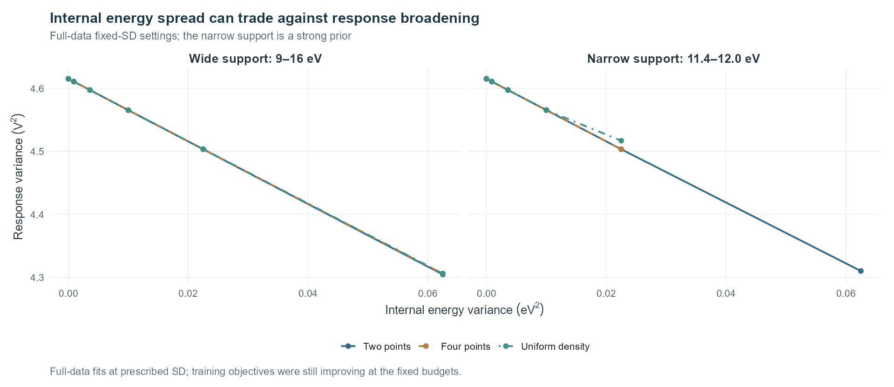

# Discrete structure and identifiability

[Project](../README.md) · [Design](design.md) · [Reproduce](reproduction.md) · [Saved manifest](../reference/discrete_diagnostics/manifest.json)

These comparisons use the same 644 measured points and the shared collision-response framework.

## Comparisons and results

| Comparison | Design | Result |
| --- | --- | --- |
| K=1–8 scan | Wide/narrow support, voltage-block holdouts, and residual perturbations. | Fitted components merge; the discrete-level count remains unresolved. |
| Matched-budget H1 | Ten single-energy continuations with the same extra update budget. | H1 reproduces the main training and holdout changes. |
| Fixed variance | H1/H2/H4/uniform profiles, selected by training objective. | Selection chooses zero variance in both full datasets and all narrow-domain folds. One wide-domain fold selects 0.06 eV with nearly equal predictions across shapes. |
| Controlled shapes | Common external parameters, mean, and variance. | Shape differences are small; predictive support remains similar across two-point, four-point, and uniform candidates. |

Support domains are 9–16 eV and 11.4–12.0 eV. The latter is a strong prior on the allowed energies. Holdouts and perturbations are internal comparisons of this measurement archive.

## Energy width and response width

Increasing the prescribed energy variance reduces the fitted Gaussian response variance. The [collapse decomposition](../reference/discrete_diagnostics/collapse_decomposition.csv) separates mean/framework changes from the variance contribution using a same-mean point under each candidate's external framework.

Coincident energies and zero weights make nominal K nonunique. Narrow continuous densities also approach point-spectrum responses. These properties explain the ambiguity between excitation representations in this response model.

## Saved material

Files are under `reference/discrete_diagnostics/`.

| Material | Files / coverage |
| --- | --- |
| Full-data replay | `parameters/`: four discrete-scan H1/H4 fits and thirty fixed-variance fits; `saved_currents.csv`: 34 × 644 predictions. |
| K scan | `scan_scores.csv`, `scan_cv.csv`, `scan_levels.csv`, `scan_path_status.csv`. |
| Residual perturbations | `noise_summary.csv`, `noise_window_stability.csv`; 40 perturbed datasets per domain, each with one H1 fit and three H4 starts. |
| Matched-budget H1 | `matched_control_scores.csv`, `matched_control_cv.csv`; ten continuations. |
| Fixed variance | `profile_scores.csv`, `profile_selected.csv`, `profile_cv.csv`, `profile_path_status.csv`, `profile_candidates.csv`. |
| Fixed-framework probes | `probe_contrasts.csv`, `probe_summary.csv`, `probe_settings.json`; original 0.5 V coordinates and prescribed distributions. |
| Analysis records | `broadening_tradeoff.csv`, `collapse_decomposition.csv`, `shape_oof_summary.csv`, `profile_protocol.json`, `decision.json`. |

The first batch contains 220 K-scan and 320 perturbation paths; matched H1 controls add ten. The variance scan contains 150 feasible paths and ten settings whose supports exceed the narrow domain. Training objectives were still improving at the fixed budgets. Status tables retain “尚未稳定” (not yet stable) and original run identifiers.

## Forward replay

Choose **mode 4** in `python run.py`. It loads the JSON parameters, evaluates 34 full-data models, and compares their currents with saved predictions. Fold, perturbation, and matched-budget runs are represented by their summary tables.

Probes use each domain's discrete-scan H1 and H4 external frameworks. The learned H4 is compared with its same-mean point. Prescribed H2/H4 probes use SD 0.10 eV; four-point versus single-point probes match the mean, while four-point versus two-point or uniform probes match both mean and variance.

Output differences are `alternative_uA - reference_uA`, with 161 voltage samples per condition. The two homepage panels use different current scales.

## 中文说明

本补充比较同一档案中的 0/4/6/8 V、644 点。宽域为 9–16 eV，11.4–12.0 eV 窄域是支持域强先验。两域全数据方差轮廓均选择零方差；窄域各折也选择零方差。宽域一折选择 0.06 eV，三种谱形预测接近，分立能级数量仍未分辨。

原批次包括 220 条 K 扫描路径。每域 40 份扰动数据各执行 1 条 H1 和 3 条 H4 初值路径，共 320 条扰动路径；另有 10 条匹配预算 H1 对照。方差扫描包含 150 条可行路径和 10 条支持域不可行设置；预算末目标仍在改善，状态表保留原记录。

模式 4 重放 34 组全数据模型和固定外部框架探针。四点与单点比较能量展宽；同均值同方差的四点、二点和均匀密度比较谱形。留出、扰动和匹配预算结果以汇总表提供。
